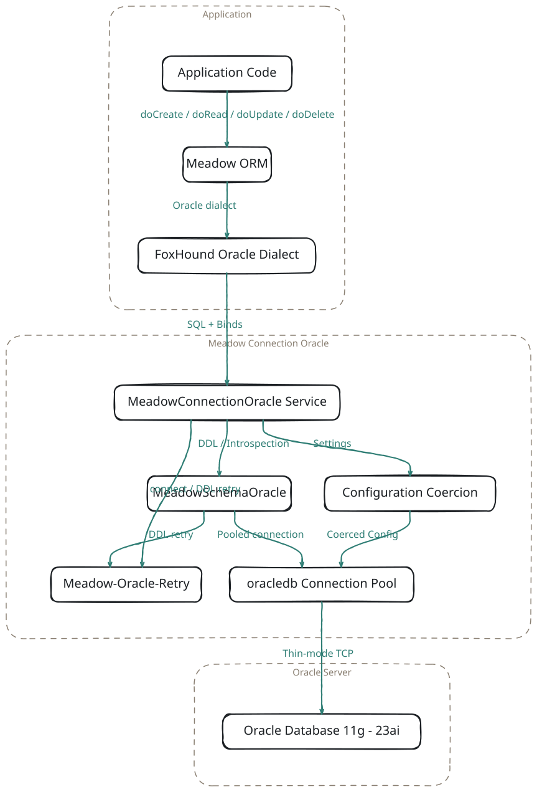
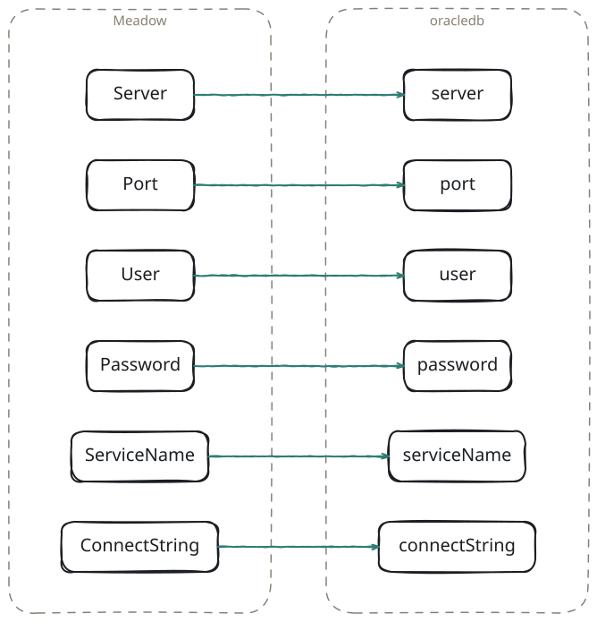
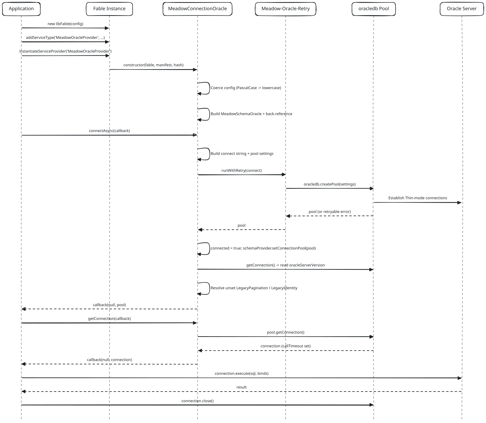
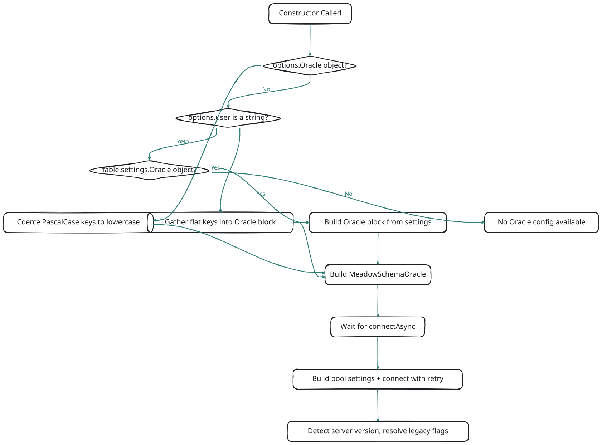
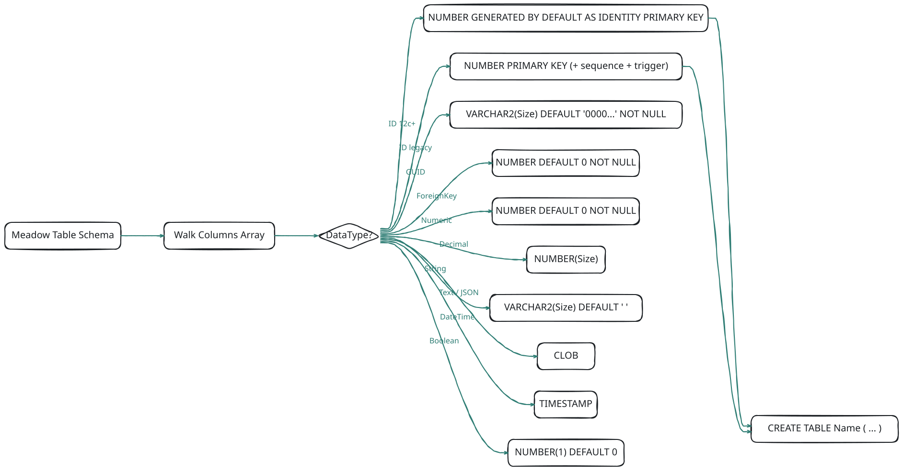
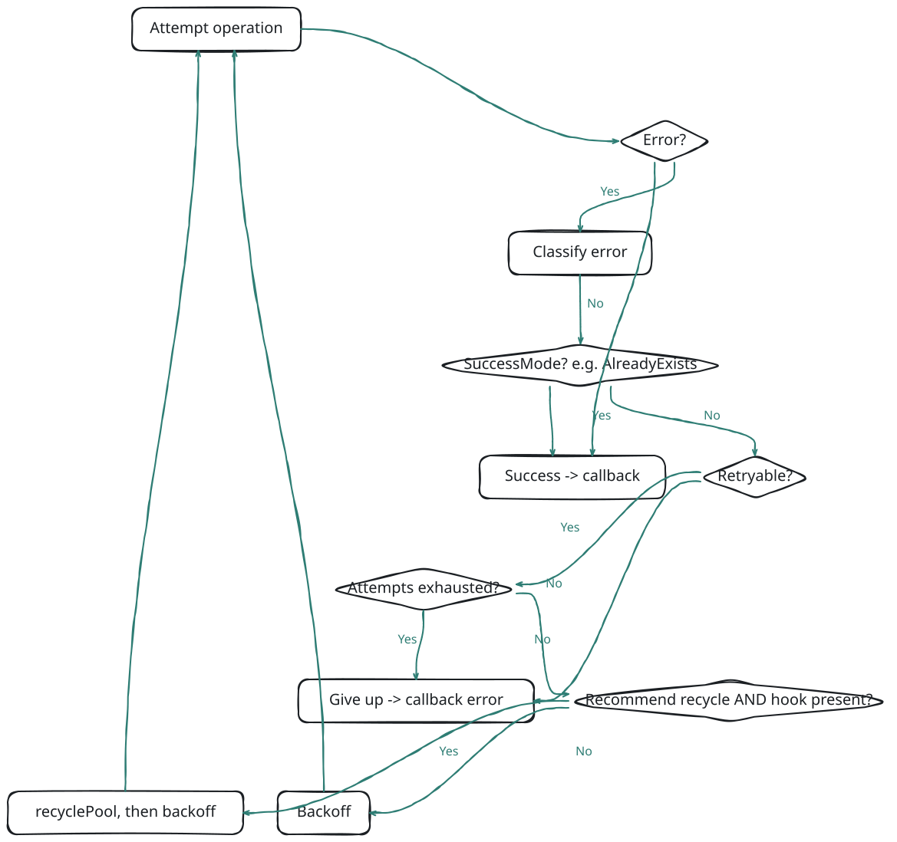
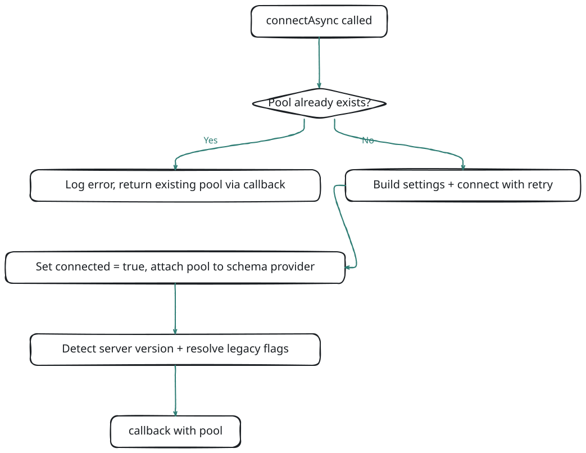
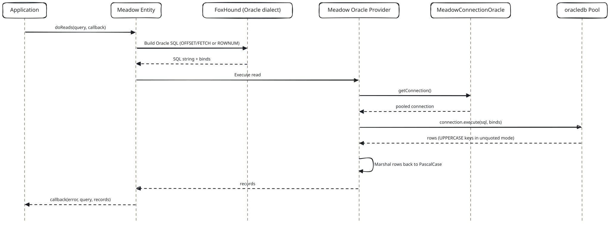

# Architecture

Meadow Connection Oracle bridges the Meadow data access layer and an Oracle Database server. This page documents the component design, data flow, the retry/reconnect machinery, the configuration pipeline, and how the connection pool integrates with the broader Retold ecosystem.

---

## System Architecture

<!-- bespoke diagram: edit diagrams/system-architecture.mmd or .hints.json, then: npx pict-renderer-graph build modules/meadow/meadow-connection-oracle/docs -->

---

## Component Responsibilities

### MeadowConnectionOracle Service

The core class, extending `FableServiceProviderBase`. It manages the lifecycle of the `oracledb` connection pool:

- **Construction** -- Reads Oracle settings from per-instance options or Fable config, coerces PascalCase keys to lowercase, and constructs a companion `MeadowSchemaOracle` with a back-reference for pool recycling. It does **not** connect during construction.
- **Pool Management** -- Builds an `oracledb.createPool()` settings object (`poolMax`, `poolMin: 0`, `poolIncrement: 1`, `poolTimeout: 30s`, `queueTimeout`), creates a single pool with retry, and guards against double-connect.
- **Server-Version Detection** -- After connecting, reads `connection.oracleServerVersion` and resolves any unset `LegacyPagination` / `LegacyIdentity` flags to modern (12c+) or legacy (11g) behavior.
- **Connection Acquisition** -- `getConnection()` hands out pooled connections with `callTimeout` set from `RequestTimeoutMs`.
- **Pool Recycling** -- `recyclePool()` closes the current pool (`close(0)`, immediate) and reconnects; invoked by the retry helper on failures that suggest a bad pooled connection.
- **DDL / Introspection Delegation** -- Forwards all schema methods to the schema provider.

### Configuration Coercion

The constructor accepts settings under an `Oracle` key in three shapes and normalizes the core connection keys to lowercase:

<!-- bespoke diagram: edit diagrams/configuration-coercion.mmd or .hints.json, then: npx pict-renderer-graph build modules/meadow/meadow-connection-oracle/docs -->

Behavioral keys (`ConnectionPoolLimit`, `RequestTimeoutMs`, `ConnectionTimeoutMs`, `ConnectRetryOptions`, `DDLRetryOptions`, `LegacyPagination`, `LegacyIdentity`, `QuoteIdentifiers`, `NumberAsString`) are read as-is from the `Oracle` block.

### oracledb Connection Pool (Thin Mode)

The underlying pool managed by [oracledb](https://github.com/oracle/node-oracledb) in **Thin mode** - a pure-JavaScript implementation that needs no Oracle Instant Client:

- Maintains pooled connections up to `poolMax` (from `ConnectionPoolLimit`, default 10), starting at `poolMin: 0`.
- Connections are acquired per operation and closed back to the pool.
- `queueTimeout` (from `ConnectionTimeoutMs`) caps how long a caller waits for a free connection.
- `oracledb.fetchAsString` is set to return `CLOB` columns (Text / JSON) as strings so the Meadow marshaller can consume them directly; `NUMBER` is added to that list when `NumberAsString` is enabled.

### MeadowSchemaOracle

A separate `FableServiceProviderBase` service that owns DDL generation, DDL execution, and introspection. The connection provider sets the pool and a back-reference on it. Keeping it separate lets DDL-string generation work without the driver connected (the generators are pure functions of the schema).

### Meadow-Oracle-Retry

A shared helper used by both providers to classify oracledb errors into failure modes and run operations with exponential backoff and optional pool recycling. See [Retry &amp; Error Classification](architecture.md#retry-and-error-classification) below.

---

## Connection Lifecycle

<!-- bespoke diagram: edit diagrams/connection-lifecycle.mmd or .hints.json, then: npx pict-renderer-graph build modules/meadow/meadow-connection-oracle/docs -->

---

## Configuration Pipeline

Settings flow through a priority chain in the constructor:

1. **`options.Oracle` object** -- If present, used directly; common PascalCase keys (`Server`, `Port`, `User`, `Password`) are coerced to lowercase.
2. **Flat options** -- If `options.user` is a string (no `Oracle` object), the flat keys are gathered into an `Oracle` block.
3. **`fable.settings.Oracle`** -- Otherwise the constructor reads Fable settings, accepting either case for the core keys.

The pool itself is created later, on `connectAsync()`.

<!-- bespoke diagram: edit diagrams/configuration-pipeline.mmd or .hints.json, then: npx pict-renderer-graph build modules/meadow/meadow-connection-oracle/docs -->

---

## DDL Generation Flow

`generateCreateTableStatement()` walks a Meadow table schema and produces Oracle DDL:

<!-- bespoke diagram: edit diagrams/ddl-generation-flow.mmd or .hints.json, then: npx pict-renderer-graph build modules/meadow/meadow-connection-oracle/docs -->

`generateCreateTableStatements()` returns an ordered array. For the 12c+ identity path that is just the `CREATE TABLE`; for the legacy (11g) path it appends a `CREATE SEQUENCE SEQ_<Table>` and a `CREATE OR REPLACE TRIGGER TRG_<Table>` that populates the ID column on insert, so the dialect's `RETURNING` clause works unchanged across versions.

Two Oracle-specific quirks are handled in the type map:

- Oracle treats `''` as `NULL`, so a `NOT NULL String` column with a `''` default would reject its own default. `String` columns therefore default to a single space and are left nullable.
- Oracle (pre-23c) has no table `BOOLEAN` type, so `Boolean` maps to `NUMBER(1)` with `0`/`1` values, matching the dialect's literal handling.

Identifiers are emitted **unquoted by default** (Oracle folds them to UPPERCASE). Setting `QuoteIdentifiers: true` wraps every identifier in double quotes to preserve case. The schema provider and the FoxHound Oracle dialect must agree on this setting.

---

## Idempotent DDL

Oracle lacks `DROP TABLE IF EXISTS` and `CREATE INDEX IF NOT EXISTS`, so the provider makes DDL idempotent itself:

- **Drop** -- `generateDropTableStatement()` wraps the drop in a PL/SQL block that re-raises everything except `ORA-00942` (table or view does not exist).
- **Create table** -- statements run sequentially; `ORA-00955` (object already exists) is swallowed per statement, so re-running a create is safe.
- **Create index** -- each index is checked against `USER_INDEXES` first and only created when absent.

---

## Retry and Error Classification

The `Meadow-Oracle-Retry` helper wraps connect and DDL operations. It classifies each oracledb error (keyed off the `ORA-NNNNN` number in `err.errorNum`, the message text, or socket-level `err.code`) into one of these modes:

| Mode | Meaning | Retryable | Recycle Pool |
|------|---------|-----------|--------------|
| `AlreadyExists` | `ORA-00955` / "name is already used" | No (treated as success) | No |
| `ServerError` | Deterministic SQL errors (syntax, missing object, bad credentials, constraint violations) | No | No |
| `RequestTimeout` | Call timeout or lock contention (`ORA-01013`, `ORA-04021`, `DPI-1067`, ...) | Yes | Yes |
| `NetworkError` | Transport failures (`ORA-03113`, `ORA-12541`, `ECONNRESET`, `ETIMEDOUT`, ...) | Yes | Yes |
| `PoolDegraded` | A fast failure (&lt;500ms) right after a prior slow (&gt;5s) timeout | Yes | Yes |
| `Unknown` | Anything else | Yes (cautiously) | No |

`runWithRetry()` then drives the operation:

<!-- bespoke diagram: edit diagrams/retry-and-error-classification.mmd or .hints.json, then: npx pict-renderer-graph build modules/meadow/meadow-connection-oracle/docs -->

Backoff is exponential (`InitialDelayMs * BackoffFactor^(attempt-1)`, capped at `MaxDelayMs`). Defaults: connect uses 5 attempts starting at 3s; DDL uses 5 attempts starting at 3s; the retry engine's base defaults are 5 attempts / 2s initial / 30s cap / factor 2. All are overridable via `Oracle.ConnectRetryOptions` and `Oracle.DDLRetryOptions`.

When a retry recommends recycling, the schema provider's retry hook calls the connection provider's `recyclePool()` and re-points the schema provider at the fresh pool before the next attempt.

---

## Double-Connect Prevention

<!-- bespoke diagram: edit diagrams/double-connect-prevention.mmd or .hints.json, then: npx pict-renderer-graph build modules/meadow/meadow-connection-oracle/docs -->

If `connectAsync()` is called when a pool already exists, it logs an error and returns the existing pool without creating a second one. A missing callback is replaced with a no-op (and a warning is logged).

---

## Meadow Integration

When Meadow uses the Oracle provider, queries follow this path:

<!-- bespoke diagram: edit diagrams/meadow-integration.mmd or .hints.json, then: npx pict-renderer-graph build modules/meadow/meadow-connection-oracle/docs -->

The pool is shared across all Meadow entities resolving the same Fable service instance. Identity inserts use FoxHound's `RETURNING` clause to return the generated key; in legacy mode the sequence + trigger populate the key so `RETURNING` still works.

---

## Comparison with Other Connectors

| Feature | Oracle | MySQL | MSSQL | SQLite |
|---------|--------|-------|-------|--------|
| Connection Type | Pool (Thin-mode TCP) | Pool (TCP) | Pool (TDS) | File handle |
| Server Required | Yes | Yes | Yes | No |
| Native Client | None (Thin mode) | mysql2 | tedious | better-sqlite3 |
| Connect Mode | Async (`connectAsync`) | Sync + async wrapper | Async | Async |
| Auto-Connect Flag | No | Yes | No | No |
| Retry / Backoff | Yes (classified) | No | No | No |
| Pool Recycling | Yes | No | No | No |
| DDL Generation | Yes (+ sequence/trigger on 11g) | Yes | Yes | No |
| Idempotent DDL | PL/SQL block + USER_INDEXES check | `IF NOT EXISTS` | Yes | N/A |
| Introspection | Yes (USER_* views) | Varies | Varies | Varies |
| Config Coercion | PascalCase -> lowercase | PascalCase -> camelCase | N/A | N/A |
| Underlying Library | oracledb | mysql2 | tedious | better-sqlite3 |
